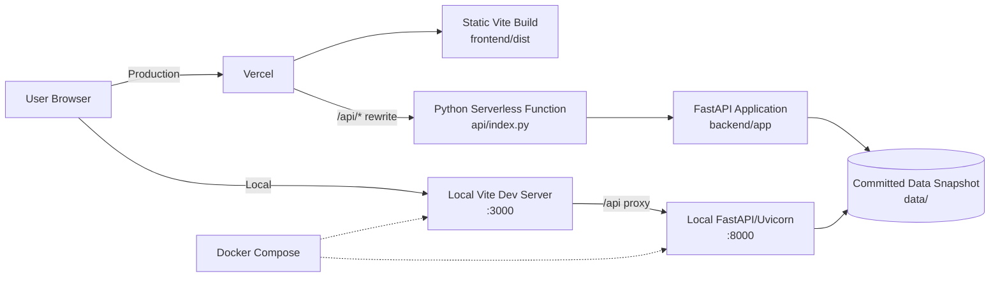

# UK Day-Ahead Wind Power Trading Platform

Live application: **[https://dpxujn.vercel.app](https://dpxujn.vercel.app)**

A full-stack intelligence and quantitative evaluation platform for a UK day-ahead electricity trading desk. It compares wind-generation forecasts with realized outturn data for January 2026 and provides decision, accuracy, and risk-buffer views.

## Features

- **Decision View:** Select a delivery date and D-1 cutoff to inspect the latest available forecast, actual outturn, forecast vintages, KPIs, and settlement-period details.
- **Accuracy View:** Review MAE, RMSE, bias, guarded MAPE, normalized MAE, error distributions, and breakdowns by day, hour, horizon, and wind level.
- **Risk Buffer View:** Calculate P50, P90, P95, and P99 shortfall buffers and review the resulting hedging profile and protection scorecard.

## Repository structure

| Path | Purpose |
| --- | --- |
| `api/` | Vercel Python serverless-function entrypoint. |
| `api/index.py` | Exposes the FastAPI application to Vercel. |
| `backend/` | FastAPI application, analysis logic, schemas, data loading, and tests. |
| `backend/app/main.py` | Creates the FastAPI app, lifecycle handler, and CORS configuration. |
| `backend/app/api/` | API route definitions. |
| `backend/app/analysis.py` | Forecast-versus-actual calculations and risk metrics. |
| `backend/app/data_store.py` | Loads the committed Parquet/JSON data snapshot into memory. |
| `backend/app/ingest.py` | Elexon BMRS data ingestion and validation logic. |
| `backend/tests/` | Backend test suite. |
| `data/` | Committed January 2026 data snapshot and data-quality report. |
| `docs/` | Architecture, assumptions, API notes, and project documentation. |
| `frontend/` | Vite, React, TypeScript, Tailwind, and charting application. |
| `frontend/src/` | Frontend pages, components, services, types, and utilities. |
| `scripts/` | Data refresh and UI walkthrough scripts. |
| `docker-compose.yml` | Local two-service Docker setup. |
| `backend/Dockerfile` | Local backend image definition. |
| `frontend/Dockerfile` | Local frontend build and Nginx image definition. |
| `requirements.txt` | Runtime Python dependencies used by Vercel. |
| `backend/requirements.txt` | Local backend dependencies, including development/test packages. |
| `frontend/package.json` | Frontend scripts and npm dependencies. |
| `vercel.json` | Vercel build, serverless-function bundle, and rewrite configuration. |
| `.env.example` | Example environment variables without secrets. |
| `.gitignore` | Local, generated, and secret-file exclusions. |
| `.dockerignore` | Files excluded from the root Docker build context. |
| `pytest.ini` | Pytest configuration and backend test discovery. |

## Data source

The committed snapshot is based on Elexon BMRS Insights Solution streams:

- **Actuals:** `FUELHH` wind data at 30-minute settlement-period granularity.
- **Forecasts:** `WINDFOR` hourly forecast runs with publication and delivery timestamps.

The application loads the snapshot at startup and does not require live BMRS access to serve the dashboard.

## Run locally with Docker

From the repository root:

```bash
docker compose up --build
```

Ports are defined in `docker-compose.yml`:

- Frontend: [http://localhost:3000](http://localhost:3000)
- Backend API: [http://localhost:8000](http://localhost:8000)
- OpenAPI docs: [http://localhost:8000/docs](http://localhost:8000/docs)
- Health endpoint: [http://localhost:8000/api/health](http://localhost:8000/api/health)

Stop the services with:

```bash
docker compose down
```

## Run locally without Docker

### Windows PowerShell

Create and activate a virtual environment, install backend dependencies, and run the API:

```powershell
py -m venv .venv
.\.venv\Scripts\Activate.ps1
python -m pip install -r backend\requirements.txt
uvicorn backend.app.main:app --reload --port 8000
```

In a second PowerShell window, install and run the frontend:

```powershell
cd frontend
npm ci
npm run dev
```

Open [http://localhost:3000](http://localhost:3000). The Vite development proxy sends `/api` requests to port `8000`.

### macOS/Linux

Create and activate a virtual environment, install backend dependencies, and run the API:

```bash
python3 -m venv .venv
source .venv/bin/activate
python -m pip install -r backend/requirements.txt
uvicorn backend.app.main:app --reload --port 8000
```

In a second terminal, install and run the frontend:

```bash
cd frontend
npm ci
npm run dev
```

Open [http://localhost:3000](http://localhost:3000). The Vite development proxy sends `/api` requests to port `8000`.

## Refresh the data snapshot

The ingestion script fetches and validates the January 2026 Elexon BMRS data and writes the generated files to `data/`.

Windows PowerShell:

```powershell
.\.venv\Scripts\Activate.ps1
python scripts\fetch_data.py
```

macOS/Linux:

```bash
source .venv/bin/activate
python scripts/fetch_data.py
```

To write to another directory for a local experiment, pass `--data-dir`. Do not replace the committed snapshot unless the refreshed files have been reviewed.

## Run tests and checks

Run the backend tests from the repository root:

```bash
pytest -v
```

Build the production frontend:

```bash
cd frontend
npm run build
```

The production frontend is generated in `frontend/dist`. It is ignored by Git and is not required for local development.

## API endpoints

- `GET /api/health`
- `GET /api/forecast/latest?delivery_date=YYYY-MM-DD&cutoff=HH:MM`
- `GET /api/forecast/vintages?target_date=YYYY-MM-DD`
- `GET /api/accuracy/summary?start=YYYY-MM-DD&end=YYYY-MM-DD&cutoff=HH:MM`
- `GET /api/accuracy/breakdown?by=day|hour|horizon|level&start=YYYY-MM-DD&end=YYYY-MM-DD&cutoff=HH:MM`
- `GET /api/accuracy/error-distribution?start=YYYY-MM-DD&end=YYYY-MM-DD&cutoff=HH:MM`

## Vercel deployment

Vercel builds the Vite frontend into `frontend/dist` and exposes `api/index.py` as the Python serverless function. The committed `data/` snapshot is included in the function bundle through `vercel.json`.

Recommended project settings:

- Framework preset: **Vite**
- Root directory: repository root (`.`)
- Build command: `npm ci --prefix frontend && npm run build --prefix frontend`
- Output directory: `frontend/dist`
- Production environment variables: none required

Production requests use relative `/api` paths. `VITE_API_URL` is only used for local Vite development when a separate API origin is needed.

## Assumptions

- The standard decision cutoff is **09:00 UK local time** on D-1.
- UK timezone handling uses `Europe/London`, including GMT/BST transitions.
- Forecast error is defined as **forecast minus actual**.
- The evaluation scope is January 1–31, 2026.
- The dashboard uses 48 half-hour settlement periods for actual outturn comparisons.

## Limitations

- The risk buffer is calculated in-sample from the January 2026 evaluation data; it is not an out-of-sample or independently backtested trading strategy.
- Results depend on the quality and coverage of the committed Elexon snapshot.
- The application does not fetch new data automatically at runtime.
- The Vercel function loads the data snapshot into memory, so serverless cold starts and memory limits may affect response latency.
- The frontend bundle currently includes charting dependencies in a large JavaScript chunk; this is a performance warning, not a functional failure.

## AI usage

This project was built with **Google Antigravity** as an AI-assisted development tool. AI assistance was used for implementation support, documentation, debugging, and validation; the repository's code, data assumptions, and deployment configuration should still be reviewed by maintainers before production use.

## Architecture


